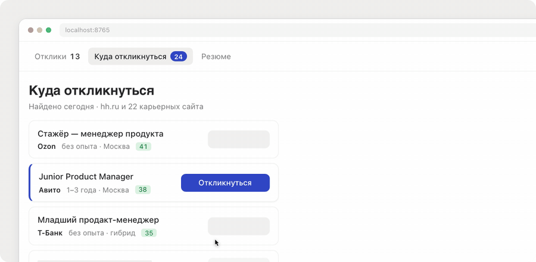
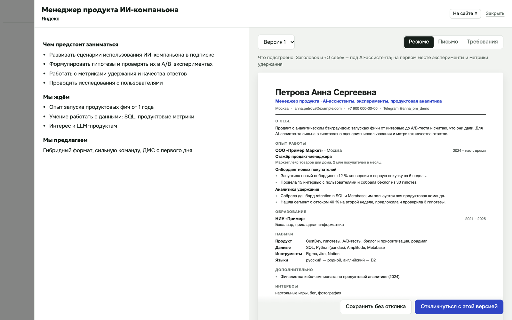
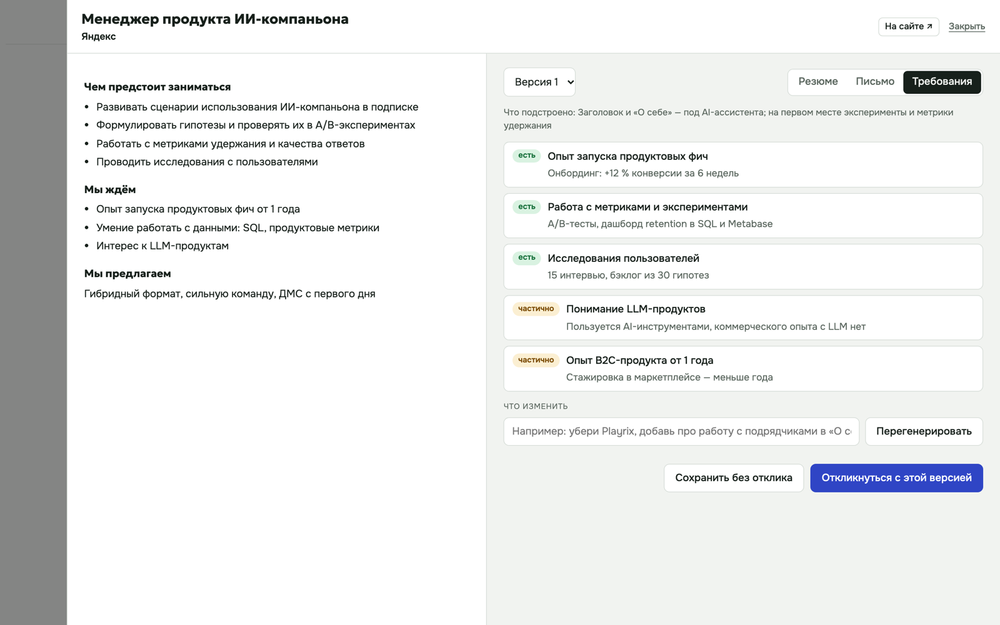
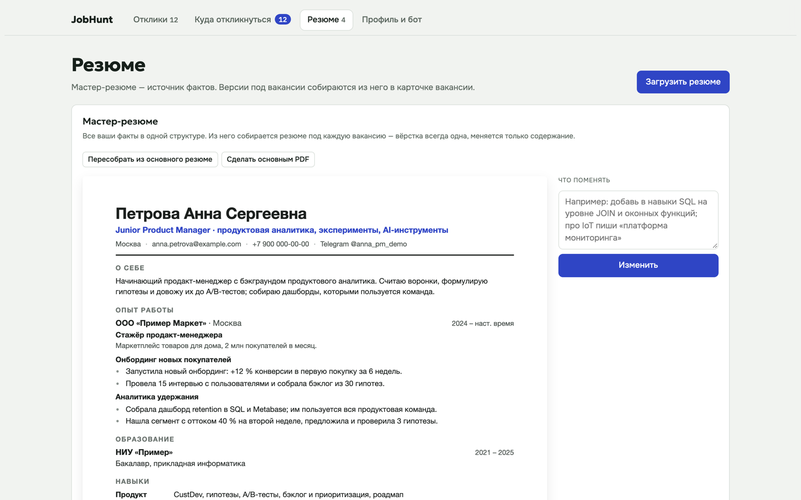
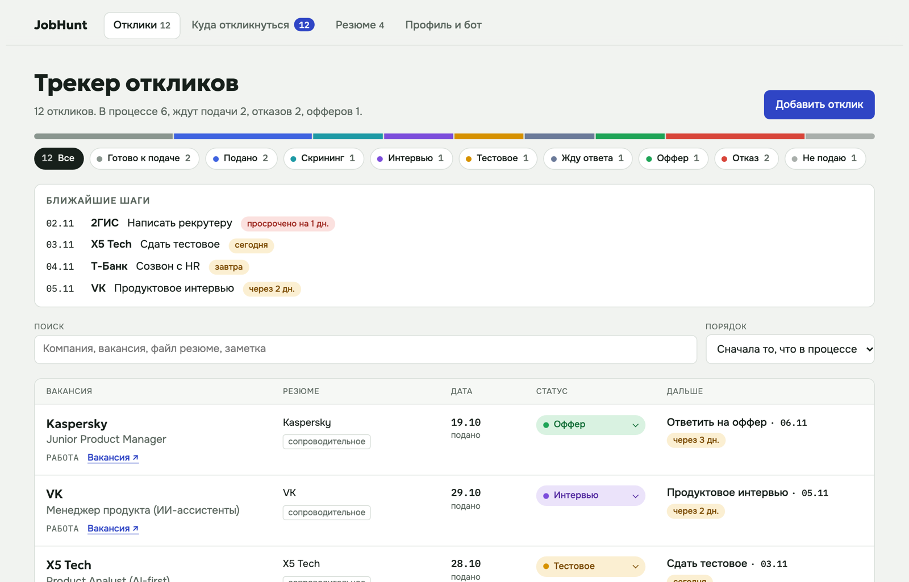
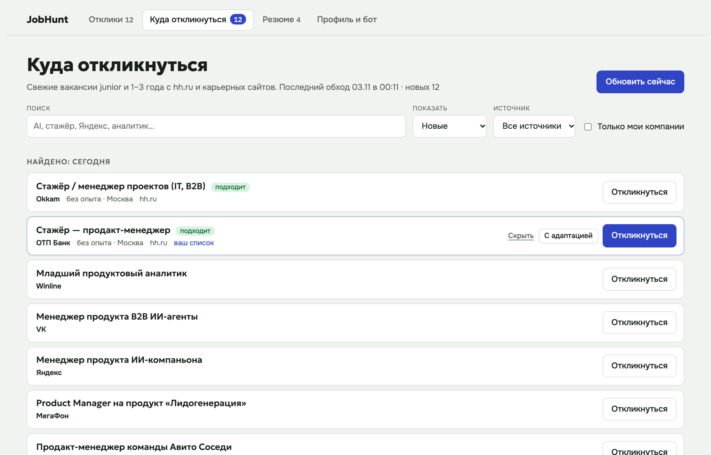

<div align="center">

# JobHunt

**Личный штаб поиска работы: трекер откликов, резюме под каждую вакансию,
бот новых вакансий и отклик в один клик.**

Работает у вас на компьютере. Данные никуда не уходят.



</div>

---

## Что умеет

| | |
|---|---|
| **Трекер откликов** | Воронка по 9 статусам, ближайшие шаги с дедлайнами, история статусов, поиск и сортировка. |
| **Бот вакансий** | Каждые 6 часов обходит hh.ru и карьерные сайты компаний (Яндекс, VK, Т-Банк, Альфа, МТС, МегаФон, X5, 2ГИС, Авито и др.), отбирает junior / 1–3 года по вашим ролям и оценивает, насколько вакансия подходит. |
| **Резюме под вакансию** | Открываете вакансию прямо в дашборде, жмёте «Подготовить» — ИИ (Claude Sonnet или Haiku) собирает резюме под её требования, письмо полное и короткое (для полей с лимитом) и разбор «требование → чем закрываю». Резюме видно сразу листом A4; не нравится — пишете, что поменять, и получаете новую версию. Откликаетесь с той версией, которую выбрали. |
| **Мастер-резюме** | Все факты в одной структуре, вёрстка одна для всех версий: образование от нового к старому, интересы и достижения отдельными разделами. Правится запросом: «добавь SQL в навыки». |
| **Отклик в один клик** | Расширение находит именно форму отклика (подписку на рассылку и поиск не трогает), при необходимости само нажимает «Откликнуться», чтобы её открыть, заполняет ФИО, контакты, письмо с учётом лимита символов и прикрепляет выбранный PDF. Подсказывает, какие обязательные поля остались. |
| **Массовый отклик** | Отметьте вакансии галочками или «Выбрать все подходящие» — они встают в очередь. Формы открываются по очереди и заполняются сами, вы проверяете и жмёте «Отправить и дальше». На hh.ru расширение само нажимает «Откликнуться» и вставляет письмо. |

<p align="center"><br>
<sub>Карточка вакансии: текст слева, резюме под неё — справа. Ниже — поле «Что изменить» и выбор версии.</sub></p>

<table>
<tr>
<td width="50%"><br><sub><b>Требования.</b> Что из вакансии вы закрываете, частично или нет.</sub></td>
<td width="50%"><br><sub><b>Мастер-резюме.</b> Источник фактов для всех версий, правится запросом.</sub></td>
</tr>
<tr>
<td width="50%"><br><sub><b>Трекер.</b> Воронка, фильтр по статусу и ближайшие шаги.</sub></td>
<td width="50%"><br><sub><b>Куда откликнуться.</b> Свежие вакансии от бота, ваши компании отмечены.</sub></td>
</tr>
<tr>
</table>

## Быстрый старт

Нужны macOS или Linux, Python 3.11+ и Chrome (или любой браузер на Chromium).

```bash
git clone https://github.com/Root010qwe/jobhunt.git
cd jobhunt
./setup.sh          # окружение, зависимости, браузер для бота (~2 минуты)
./run.sh --demo     # посмотреть на вымышленном кандидате
./run.sh            # начать со своими данными
```

Откройте **http://localhost:8765**. Дальше:

1. **Профиль и бот** — заполните ФИО и контакты: их расширение подставит в формы.
2. **Резюме** — загрузите PDF или DOCX, затем «Собрать из основного резюме»: получится мастер-резюме. Проверьте его и поправьте запросом, если нужно.
3. **Куда откликнуться** → «Обновить сейчас» — бот пройдёт по сайтам за 2–3 минуты.
4. Кликните по вакансии → «Подготовить резюме и письмо» → посмотрите, поправьте → «Откликнуться с этой версией».

### Расширение для отклика в один клик

1. Откройте `chrome://extensions` и включите «Режим разработчика».
2. «Загрузить распакованное расширение» → папка `extension/`.
3. Нажмите «Откликнуться» у вакансии — сайт откроется, форма заполнится, останется проверить и отправить.

Если вакансии нет в трекере, расширение всё равно предложит заполнить форму, а после отправки само заведёт отклик.

### Массовый отклик

1. **Куда откликнуться** → отметьте вакансии или нажмите «Выбрать все подходящие».
2. «Массовый отклик» — отклики заводятся со статусом «Готово к подаче» и встают в очередь. Галочка «Письмо под каждую с ИИ» сначала напишет письма (около 30 секунд на вакансию).
3. Откроется первая вакансия. В плашке расширения: **«Отправить и дальше»** — отправит форму, отметит «Подано» и откроет следующую; **«Пропустить»** — уберёт вакансию из очереди.

Каждую форму вы видите перед отправкой: у компаний бывают обязательные вопросы, которые расширение не заполнит. Прервать можно когда угодно — «Продолжить очередь» на вкладке вакансий вернёт к следующей.

### Адаптация резюме с ИИ

Использует [Claude Code](https://docs.claude.com/en/docs/claude-code) — команду `claude`, если она установлена и вы в ней авторизованы. Модель (Sonnet по умолчанию, Haiku быстрее) выбирается в настройках. Без Claude Code всё остальное работает, письмо берётся из шаблона.

Как ИИ адаптирует: выписывает требования вакансии, ставит самый релевантный опыт первым, переформулирует пункты словами вакансии, показывает переносимый опыт. Работодателей, сроки, цифры и технологии не выдумывает — это вскрывается на собеседовании. Пробелы видны только вам, во вкладке «Требования».

## Настройка бота

Всё в [`app/sources.json`](app/sources.json) — или во вкладке «Профиль и бот»:

```jsonc
{
  "keywords": {
    "include": ["продукт", "product", "проект", "аналитик", ...],  // роль обязана быть в названии
    "exclude": ["senior", "lead", "разработчик", ...],             // отсекаются
    "boost":   ["junior", "стаж", "ai", ...]                       // поднимают в выдаче
  },
  "hh": {
    "queries":    ["product manager", "продуктовый аналитик"],   // поиск по роли
    "employers":  ["КРОК", "ЛАНИТ", "Selectel", ...],            // все вакансии этих работодателей
    "experience": ["noExperience", "between1And3"]
  },
  "companies": [
    { "name": "Яндекс", "url": "https://yandex.ru/jobs/vacancies?text=менеджер продукта",
      "pattern": "/jobs/vacancies/[^/?#]+-\\d+" }                   // как выглядит ссылка на вакансию
  ]
}
```

Из коробки бот следит примерно за 90 компаниями: ~70 работодателей на hh.ru (включая [рейтинг 77 крупнейших IT-корпораций России](https://hightime.media/raiting-it-korporaciy/) от HighTime) и 27 карьерных сайтов напрямую. Чтобы добавить компанию, впишите её название в `employers` — или, если у неё свой карьерный сайт, укажите страницу со списком вакансий и шаблон ссылки на одну вакансию. Проверить, что видит бот:

```bash
.venv/bin/python tools/debug_site.py "Яндекс"
```

## Как устроено

```
app/
  main.py        API и раздача интерфейса (FastAPI)
  crawler.py     бот: Playwright обходит сайты, фильтрует и оценивает вакансии
  ai.py          мастер-резюме, адаптация под вакансию и письма через claude -p
  resume_model.py  резюме как структура данных и единая вёрстка A4
  resumes.py     импорт PDF/DOCX, сборка PDF на одну страницу
  demo.py        демо-данные
web/             интерфейс без сборки: HTML, CSS, JS
extension/       расширение Chrome (Manifest V3)
data/            ваша база SQLite и резюме — в git не попадает
```

Сервер слушает только `127.0.0.1`. Профиль, резюме и отклики лежат в `data/` на вашем диске; наружу уходят только запросы к сайтам вакансий и текст для ИИ-адаптации, если вы её запускаете.

## Частые вопросы

**Почему нет Ozon и Wildberries в списке сайтов?** Их карьерные сайты закрыты от ботов, поэтому их вакансии приходят через hh.ru.

**Отклик на hh.ru тоже в один клик?** Почти: расширение вставит сопроводительное письмо, резюме вы выбираете в самом hh.

**Можно держать несколько профилей?** Да: `JOBHUNT_DATA=~/jobhunt-anna ./run.sh` — у каждой папки своя база.

**Как запускать автоматически?** Добавьте `run.sh` в автозапуск (на macOS — через `launchd` или «Объекты входа»), иначе бот работает, только пока открыт сервер.

## Лицензия

MIT. Анимация в начале README собрана набором [stageshow](https://github.com/benjitaylor/skills) (MIT), исходник сцены — в [`docs/hero-src`](docs/hero-src).
